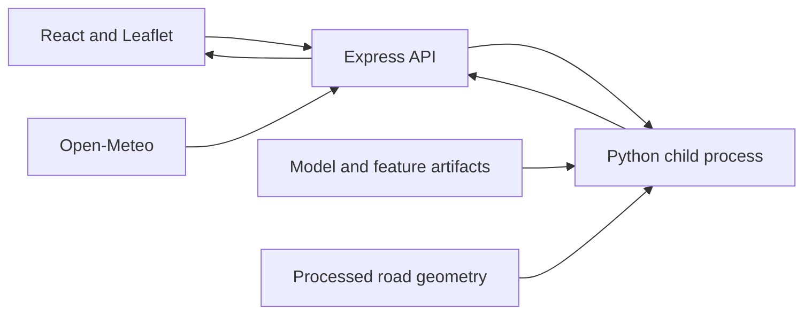

# Road Risk Prediction

A Chennai road map connected to a Python accident-severity model through an Express API. The project combines a model score with road geometry to explore how risk estimates can be presented at road-segment level.

**Status:** the frontend and risk-fusion tests run from this checkout. Full prediction needs model and processed geometry files that are not committed. See [required artifacts](docs/data-and-models.md) before running the API.

## What it does

- Displays Chennai road segments on an interactive Leaflet map.
- Fetches current weather context for Chennai through the backend.
- Sends road and time features to a Python inference process.
- Combines normalized ML output with a precomputed geometry score.
- Shows LOW, MEDIUM or HIGH risk, along with the component scores.

## Architecture



The score is `0.65 × ML risk + 0.35 × geometry risk`. Both components use a 0–100 scale. Scores below 35 are LOW, scores from 35 to below 70 are MEDIUM, and scores of 70 or above are HIGH. These weights are heuristic.

## Run locally

Use Node.js 22.12+ and Python 3.11 or 3.12. Clone the repository, then start the frontend:

```bash
cd frontend
npm ci
npm run dev
```

Open **http://localhost:5173**. The road geometry file is included, so the map can load before inference is configured.

For predictions, prepare the files described in [data-and-models.md](docs/data-and-models.md), then from the repository root:

```bash
python -m venv ml-engine/.venv
```

Activate it with `ml-engine\.venv\Scripts\Activate.ps1` in PowerShell, or `source ml-engine/.venv/bin/activate` on macOS/Linux:

```bash
python -m pip install -r ml-engine/requirements.txt
cd backend
npm ci
npm start
```

The backend runs on port **5000** and automatically finds `ml-engine/.venv`. Set `PYTHON_EXECUTABLE` to use another Python interpreter. The frontend uses `/api` through the Vite proxy; set `VITE_API_BASE_URL` at build time when hosting the API separately. Example environment files are included in both folders.

## API example

```bash
curl -X POST http://localhost:5000/api/risk/predict -H "Content-Type: application/json" -d '{"road_index":0}'
```

`road_index` is a non-negative integer indexing a row in the processed geometry CSV. The API supplies weather and current Chennai time. It returns `ml_risk`, `geometry_risk`, `final_risk`, `risk_tier`, `weather`, `temperature` and `hour`. The API request only succeeds when the required artifacts are present and compatible.

## Checks

```bash
cd frontend
npm ci
npm run lint
npm run build
```

```bash
cd backend
npm ci
npm test
```

```bash
cd ml-engine
python -m unittest discover -s tests -v
```

The tests cover score boundaries, risk fusion and the Python process bridge. They do not validate model accuracy.

## Data and limitations

The baseline model uses accident data from outside Chennai. Its output is not a calibrated accident probability for Chennai roads. Visibility and humidity currently use fixed fallback values; weather comes from a city-level observation. The browser uses a heuristic mapping from road identifiers to geometry row indices, so spatial correspondence needs validation before interpreting individual predictions.

This is an exploratory project, not a road-safety decision tool. Local ground-truth evaluation, artifact versioning and a stable road-ID mapping are the main next steps. The repository does not currently implement route optimization or a PostgreSQL persistence layer.

## Code map

- `frontend/src/App.jsx`: map, road selection and result popup.
- `backend/controllers/riskController.js`: request validation and weather context.
- `backend/utils/runPython.js`: Python process bridge.
- `ml-engine/src/inference/`: inference and risk-fusion logic.
- `ml-engine/src/geo/`: road geometry preparation.
- `ml-engine/experiments/`: model comparison and analysis scripts.

Road geometry comes from [OpenStreetMap](https://www.openstreetmap.org/copyright); map tiles retain OpenStreetMap contributor attribution. Weather is supplied by [Open-Meteo](https://open-meteo.com/).
